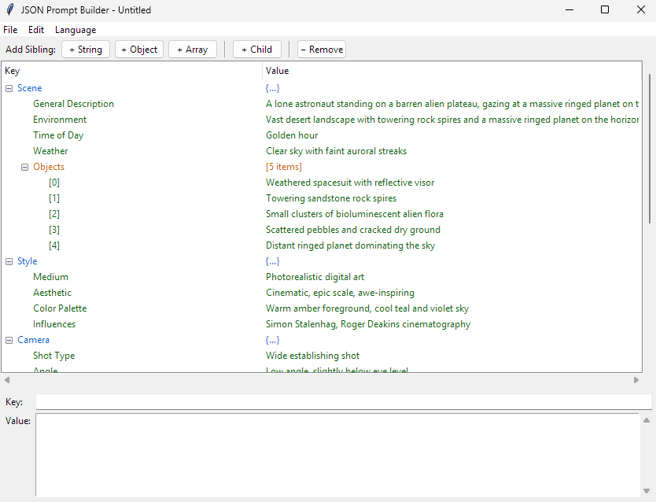

# JSON Prompt Builder

A lightweight GUI tool for creating and editing structured JSON prompts for AI image and video generation. Built with Python and Tkinter — no external dependencies required.


## Features

- **Visual JSON tree editor** — view and edit your prompt structure as an expandable tree
- **Inline editing** — double-click any key or value to edit it directly
- **Detail panel** — a resizable panel below the tree displays the full text of long values with word wrap
- **Add / remove fields** — toolbar buttons and right-click context menu to add siblings, children, objects, and arrays
- **Type conversion** — convert any field between String, Number, Boolean, Null, Object, and Array via right-click
- **Drag-and-drop reordering** — drag items to reorder them among their siblings
- **Copy and paste** — right-click to copy any item and paste it as a sibling elsewhere
- **Value suggestions** — a filterable dropdown of suggested values for common fields (shot size, lens, lighting, and more)
- **Clipboard export** — copy the prompt as JSON, condensed JSON (empty fields removed), or plain text
- **Example templates** — built-in examples optimized for AI image and video generation (File > Load Example)
- **Multi-language UI** — English and French out of the box, with easy extensibility
- **Persistent preferences** — language choice is saved to `user.ini` and restored on next launch
- **Keyboard shortcuts** — Ctrl+N, Ctrl+O, Ctrl+S, Insert, Delete, and more



## Quick Start

The recommended way to run the app is with [uv](https://docs.astral.sh/uv/). uv downloads its own copy of Python (Tkinter included), so you don't need to install Python or any system packages, and every OS runs the same version.

### 1. Install uv (once)

**Windows** (PowerShell):

```
powershell -ExecutionPolicy ByPass -c "irm https://astral.sh/uv/install.ps1 | iex"
```

**macOS / Linux**:

```
curl -LsSf https://astral.sh/uv/install.sh | sh
```

### 2. Run the app

- **Windows**: double-click `JSON_Prompt_Builder.bat`
- **macOS / Linux**: double-click `JSON_Prompt_Builder.command`
- **Any OS, from a terminal** in the project folder:

  ```
  uv run main.py
  ```

The first run downloads Python (the version in `.python-version`) and creates a `.venv/` folder in the project. Later runs start immediately.

### Without uv

The launchers fall back to the system Python if uv isn't installed. You need Python 3.10 or later with Tkinter:

- **Windows / macOS**: the installers from [python.org](https://www.python.org/downloads/) include Tkinter.
- **Linux**: Tkinter is often a separate package, e.g. `sudo apt install python3-tk` (Debian/Ubuntu), `sudo dnf install python3-tkinter` (Fedora) or `sudo pacman -S tk` (Arch).

Then run `python main.py` (Windows) or `python3 main.py` (macOS/Linux).

## Usage

| Action | How |
|---|---|
| Edit a key or value | Double-click it in the tree |
| Edit long text | Select the item and use the detail panel at the bottom |
| Add a sibling field | Select an item, then click **+ String**, **+ Object**, or **+ Array** |
| Add a child field | Select a container (object/array), then click **+ Child** |
| Remove a field | Select it and click **- Remove** or press `Delete` |
| Change field type | Right-click > **Convert To** > choose type |
| Load an example | **File > Load Example** > choose a template |
| Switch language | **Language** menu > choose language |
| Clear everything | **Edit > Clear All** |

## Keyboard Shortcuts

| Shortcut | Action |
|---|---|
| `Ctrl+N` | New file (reset to default template) |
| `Ctrl+O` | Open JSON file |
| `Ctrl+S` | Save |
| `Ctrl+Shift+S` | Save As |
| `Insert` | Add sibling |
| `Delete` | Remove selected item |

## Example JSON Output

```json
{
    "Scene": {
        "General Description": "A lone astronaut on an alien plateau",
        "Environment": "Desert landscape with rock spires",
        "Time of Day": "Golden hour",
        "Weather": "Clear sky",
        "Objects": [
            "Weathered spacesuit",
            "Bioluminescent alien flora"
        ]
    },
    "Style": {
        "Medium": "Photorealistic digital art",
        "Aesthetic": "Cinematic, epic scale",
        "Color Palette": "Warm amber foreground, cool teal sky"
    },
    "Camera": {
        "Shot Type": "Wide establishing shot",
        "Angle": "Low angle",
        "Lens": "24mm wide-angle",
        "Depth of Field": "Deep focus"
    },
    "Lighting": {
        "Key Light": "Warm directional sunlight",
        "Atmosphere": "Volumetric light rays"
    },
    "Technical": {
        "Resolution": "8K",
        "Aspect Ratio": "16:9"
    }
}
```

## Project Structure

```
JSON_Prompt_Builder/
├── main.py                      # Entry point
├── app.py                       # Main window, menus, toolbar
├── json_tree.py                 # Tree widget with inline editing & detail panel
├── file_handler.py              # JSON file I/O
├── config.py                    # Paths, default template and suggestion loaders
├── locale_handler.py            # Multi-language support
├── user_settings.py             # Persistent user preferences (user.ini)
├── tooltip.py                   # Hover tooltip widget
├── pyproject.toml               # Project metadata for uv
├── .python-version              # Python version used by uv
├── JSON_Prompt_Builder.bat      # Windows launcher
├── JSON_Prompt_Builder.command  # macOS / Linux launcher
├── examples/                    # Prompt templates (File > Load Example)
│   ├── empty_template.json      # Default template (English)
│   ├── empty_template_FR.json   # Default template (French)
│   ├── default_image.json
│   ├── default_image_FR.json
│   ├── default_video.json
│   └── default_video_FR.json
├── locale/                      # UI translation files
│   ├── en.json
│   └── fr.json
└── suggestion/                  # Value suggestions, one .txt file per field
    ├── shot_size.txt
    ├── time_of_day.txt
    └── ...
```

## Adding a New Language

1. Copy `locale/en.json` to `locale/xx.json` (where `xx` is the language code).
2. Translate all the string values, including `"language_name"`, which is the name shown in the **Language** menu.
3. Optionally add `examples/empty_template_XX.json` (uppercase code) as the default template for that language. Without it, the English template is used.

The new language appears in the **Language** menu automatically. No code changes needed.

## Adding Value Suggestions

Each `.txt` file in `suggestion/` holds suggestions for one field, one value per line. The file name (without `.txt`) is matched against the key being edited, ignoring case. For example, `suggestion/time_of_day.txt` provides suggestions for a `time_of_day` field. Add or edit files at any time; changes are picked up on the next edit, without restarting.

## Adding Custom Examples

Drop any `.json` file into the `examples/` folder. It will automatically appear under **File > Load Example** the next time you open the menu. File names are displayed with underscores replaced by spaces and title-cased (e.g., `my_custom_prompt.json` shows as "My Custom Prompt").

## License

MIT
